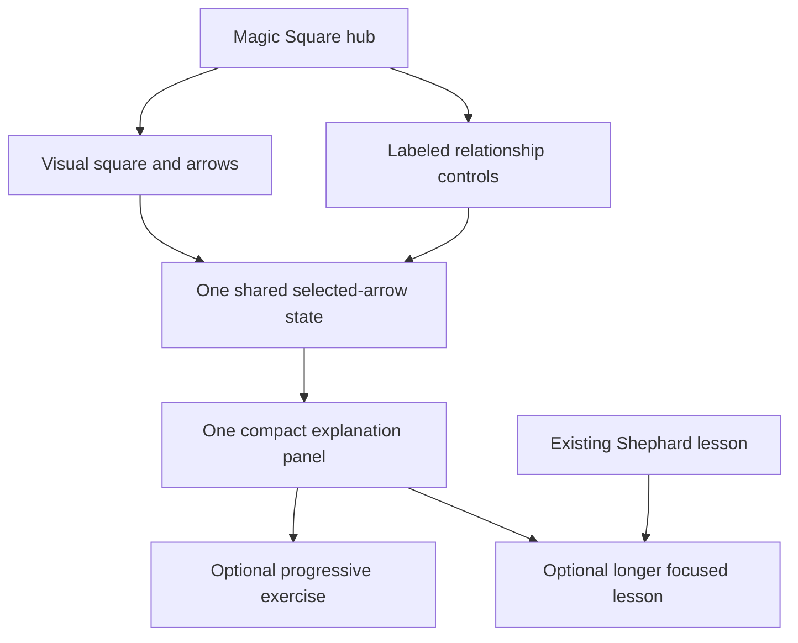

## Goal Capsule

- **Objective:** Students can use one clear, interactive Magic Square map to understand how the four consumer-theory objects connect, one relationship at a time.
- **Means:** Add a central Magic Square hub with selectable arrows and compact explanation panels, while retaining longer focused lessons when an arrow needs more space.
- **Authority:** The instructor's reviewed content controls the mathematics, terminology, examples, and teaching order. Existing site style and accessibility patterns control presentation unless the instructor approves a change.
- **Stop conditions:** Do not implement an arrow's full lesson until its content has been reviewed in conversation. Stop and surface a blocker if the square's economic relationships or notation are ambiguous.
- **Execution profile:** Incremental, content-first, browser-verified static HTML with no build step or new dependencies.

## Product Contract

### Summary

Create a student-facing Magic Square hub that keeps the four objects visible while students explore the directed relationships among them. Each selected arrow reveals a focused explanation below the map, and longer explanations can link to a dedicated lesson.

### Problem Frame

The current Shephard's Lemma page works as a focused lesson, but the broader Magic Square is not yet available as a navigable structure. Students need to see the whole map without being confronted with all of its explanations at once, and the instructor needs a repeatable way to review each arrow's content before it is built.

### Actors

- **Student:** Selects relationships, reads the explanation, completes any included interaction, and moves to another arrow.
- **Instructor/content author:** Reviews and revises each arrow's intuition, notation, examples, and exercises before implementation.

### Requirements

- R1. The hub presents the four objects—Marshallian demand, indirect utility, Hicksian demand, and the expenditure function—and the eight directed relationships in the canonical inventory below.
- R2. Selecting an arrow highlights that relationship and reveals only its associated explanation panel below the map.
- R3. Students can navigate to the same relationships through labeled controls outside the diagram, including on narrow screens and with a keyboard or screen reader.
- R4. The hub gives every arrow a concise explanation, while a relationship that needs a longer treatment may link to a focused lesson.
- R5. Arrow lessons follow the established teaching pattern: concrete intuition before notation, a student prediction or calculation before the answer when useful, progressive disclosure, short readable chunks, and a formal statement after the intuition.
- R6. Arrow lessons use notation consistently, identify what is held fixed, distinguish related concepts explicitly, and avoid unexplained technical terms.
- R7. The Shephard's Lemma lesson remains the reference implementation for interactive explanation, including hidden answers, direct/indirect-effect color coding, and a mobile-safe interactive figure.
- R8. The hub and lessons work as static local files with the existing shared stylesheet, no build step, and no new runtime dependencies.
- R9. The instructor can review each arrow as a separate content milestone; revisions to one arrow do not require inventing or implementing the prose for the others.
- R10. The student-facing hub does not expose an unfinished arrow as a finished lesson; the hub is linked from the landing page only after every arrow has at least an approved compact panel.

### Canonical Relationship Inventory

- Marshallian demand → indirect utility: evaluate utility at the Marshallian bundle, `V(P,I) = U(X^M(P,I), Y^M(P,I))`.
- Indirect utility → Marshallian demand: apply Roy's identity, `X^M = −V_{P_X}/V_I` and `Y^M = −V_{P_Y}/V_I`.
- Hicksian demand → expenditure function: add up spending on the Hicksian bundle, `E(P,U) = P_X X^H(P,U) + P_Y Y^H(P,U)`.
- Expenditure function → Hicksian demand: apply Shephard's Lemma, `X^H = E_{P_X}` and `Y^H = E_{P_Y}`.
- Indirect utility → expenditure function: invert indirect utility with respect to income, `V(P,E(P,U)) = U`.
- Expenditure function → indirect utility: invert the expenditure function with respect to utility, `E(P,V(P,I)) = I`.
- Marshallian demand → Hicksian demand: evaluate Marshallian demand at the expenditure needed to reach the target utility, `X^H(P,U) = X^M(P,E(P,U))` and likewise for Y.
- Hicksian demand → Marshallian demand: evaluate Hicksian demand at the utility reached by available income, `X^M(P,I) = X^H(P,V(P,I))` and likewise for Y.

### Key Decisions

- K1. The Magic Square is the primary navigation surface, with one selected arrow panel open at a time. This keeps the whole structure visible without presenting eight lessons at once.
- K2. The hub uses compact arrow explanations and may link to longer focused lessons. This preserves the Shephard page's depth without recreating a wall of text in the hub.
- K3. Each arrow is developed through a content-review gate before implementation. This makes mathematical and pedagogical review independent of UI work.
- K4. The hub uses the eight-arrow inventory above, including the two reverse definition arrows requested for the map. This makes the visual map, content milestones, and landing-page description agree.

### Key Flows

- F1. **Explore the map:** Student opens the hub, sees the four objects and arrows, selects one relationship, reads the revealed panel, and selects another relationship.
- F2. **Use an accessible control:** Student uses the labeled relationship controls instead of the visual arrow, receives the same selected state and panel, and can move focus predictably.
- F3. **Complete an arrow lesson:** Student encounters the arrow's intuition, attempts an exercise when included, checks the response, and then sees the explanation or formal derivation.
- F4. **Review and add an arrow:** Instructor reviews the content draft for one arrow, requests revisions or approves it, and only then has that arrow implemented and browser-checked.

### Acceptance Examples

- AE1. Opening the hub shows the square and no more than one arrow lesson panel.
- AE2. Selecting a different arrow moves the highlight and replaces the previous panel without requiring a page reload.
- AE3. Selecting an arrow from the labeled control list produces the same result as selecting it from the diagram.
- AE4. A student who submits an answer before seeing a calculation receives feedback and then sees the relevant explanation; the answer is not visible in the initial state.
- AE5. On a narrow viewport, the map remains usable through the labeled controls, and formulas or diagrams do not create page-wide horizontal overflow.
- AE6. The Shephard panel or linked lesson preserves the approved gas example, price-term exercise, chain-rule explanation, and direct/indirect-effect visual distinction.

### Success Criteria

- A student can identify all four objects and choose any relationship without needing to read a long introductory page.
- The selected relationship is visually and textually unambiguous.
- The instructor can approve arrow content one relationship at a time and revise it without destabilizing already approved lessons.
- The hub feels lighter than a page containing all eight lessons expanded simultaneously.
- After reviewing an arrow, a student can identify its direction, what is held fixed, and the operation or formula that recovers the destination object.

### Scope Boundaries

#### In scope

- A new Magic Square hub and its interaction model.
- The eight directed relationships in the canonical inventory.
- Compact content for each relationship, added in reviewed milestones.
- Reuse or linking of the existing Shephard's Lemma lesson.
- Updating the site landing page when the hub is ready for students.
- Responsive and accessible navigation and browser verification.

#### Deferred to follow-up work

- Rewriting the Shephard lesson solely for stylistic consistency if the hub can use it successfully as-is.
- Additional consumer-theory tools outside the eight Magic Square relationships.
- A framework, content-management system, or data-driven authoring pipeline.

## Planning Contract

### Key Technical Decisions

- KTD1. **Use a self-contained static hub with hidden panels and shared selection state.** The repository has one-file HTML tools, no build step, and no runtime dependencies; the new hub should extend that pattern rather than introduce a framework.
- KTD2. **Keep the detailed Shephard lesson separate initially and expose it from the hub.** The current lesson is already a substantial, tested teaching artifact. A compact hub panel plus a clear continuation link avoids duplicating or compressing that lesson prematurely.
- KTD3. **Treat the diagram and labeled controls as two views of one interaction.** The SVG arrows are mouse/touch targets with matching names and keyboard behavior; the labeled relationship controls provide a reliable equivalent surface for keyboard, screen-reader, and mobile use.
- KTD4. **Implement content in arrow-sized units.** Each unit begins with a reviewed content outline and ends with a browser pass covering both the mathematics and the interaction states.
- KTD5. **Use a shared mathematical consistency pass.** Substantive arrows may use different examples, but every approved formula, held-fixed condition, and recovered bundle must be checked against one canonical consumer problem before release.
- KTD6. **Keep the visual map secondary on narrow screens.** The square may scale or scroll within its own figure, while the full-width labeled controls remain the primary reliable way to select a relationship.

### High-Level Technical Design

The hub owns the map, selection state, panel visibility, accessible labels, and the eight-arrow inventory. Each arrow's panel owns only its student-facing explanation and any exercise-specific behavior. The visual arrows and labeled controls call the same selection behavior; each exposes a clear accessible name and selected state, the panel is associated with the selected control, and a live status message announces the newly selected relationship. Incomplete arrows remain non-selectable during development and the hub is not linked from the landing page until all compact panels are approved.

### Existing Patterns to Reuse

- `magic-square/shephard/index.html` for concrete-first exposition, progressive disclosure, answer feedback, math markup, color semantics, and interactive figure behavior.
- `assets/style.css` for typography, spacing, cards, figures, responsive behavior, and the existing visual language.
- `index.html` for the landing-page card and static site navigation.
- The repository's no-build, self-contained HTML convention for offline/local preview and GitHub Pages hosting.

### Sequencing

1. Build and verify the hub shell with the complete square, all arrow labels, accessible controls, and empty or clearly marked panel slots.
2. Add the Shephard relationship as the reference panel/link and confirm that the hub interaction works with a substantial lesson.
3. Draft and review the two definition arrows, then implement them as short panels.
4. Draft and review Roy's Identity, then implement it as the next substantive arrow lesson.
5. Draft and review the indirect utility/expenditure relationship, then implement both directions with clear direction labels.
6. Draft and review the Marshallian/Hicksian relationship, then implement both directions with the distinction between income-fixed and utility-fixed choices.
7. Run a complete content, accessibility, responsive, and navigation pass; update the landing page link when the hub is ready.

### Content Review Protocol

For every arrow, the working sequence is: identify the starting object and destination; draft the student-facing intuition and formal relationship; add an exercise only when it earns its space; get instructor revisions or approval; implement; then browser-check the approved content. The implementation plan does not pre-decide the exact examples or wording for the unreviewed arrows.

### Assumptions

- The eight-arrow inventory above is the intended Magic Square for this resource.
- During development, incomplete arrows may be shown locally as disabled and marked "in progress," but they are not part of the student-facing release state.
- The existing Shephard page remains valid and is not deleted as part of this work.
- Manual browser verification is the primary test method because the repository has no automated test harness.

## Implementation Units

### U1. Build the Magic Square hub shell

- **Goal:** Give students a usable map of the four objects and eight relationships.
- **Requirements:** R1, R2, R3, R8, R10.
- **Files:** `magic-square/index.html`, `index.html`.
- **Approach:** Add the hub page using the existing visual language. Represent each relationship in the canonical inventory as a selectable control with a clear direction label. Keep the diagram and the labeled control list synchronized through one selection model. Keep hub-only styles page-local; treat `assets/style.css` as a read-only style reference. Update the landing-page card only when the hub is ready for student-facing use.
- **Test scenarios:**
  - Open the hub with no selection and verify the map, labels, and initial panel state are clear.
  - Verify that all eight visual arrows and labeled controls exist; once their panels are complete, select each and verify that exactly one relationship is highlighted and exactly one panel state is active.
  - Select each labeled control and verify it produces the same state as the matching visual arrow.
  - Use Tab, Enter, and Space to select relationships and verify focus remains visible and predictable.
  - Open the hub at a narrow viewport and verify the fallback controls remain readable and usable.
  - Verify an unfinished local arrow is visibly marked in progress, is not selectable, and is not linked from the student-facing landing page.
- **Verification:** Local browser smoke test plus `git diff --check`; no automated test file exists in the repository.

### U2. Add shared panel behavior and progressive disclosure

- **Goal:** Make selected-arrow explanations appear below the square without overwhelming the page.
- **Requirements:** R2, R4, R5, R8.
- **Files:** `magic-square/index.html`, `assets/style.css`.
- **Approach:** Keep unselected panels hidden and reveal the selected panel with a clear heading and direction. Support switching arrows without a reload, keep focus on the activating control, associate the panel with that control, and announce the selection through a live status message. Use the established answer-reveal pattern for exercises rather than exposing answers in the initial state; when an exercise is included, define its empty, invalid, incorrect, correct, retry, and completed states.
- **Test scenarios:**
  - Select one arrow, verify its explanation appears below the map, then select another and verify the first closes.
  - Reload a selected-arrow deep link if implemented and verify the same panel opens.
  - Verify a panel with an exercise hides its answer until the student submits or requests it, and that empty, invalid, incorrect, correct, retry, and completed states are recoverable and understandable.
  - Verify explanatory content is not visually present below every arrow in the initial state.
  - Verify selection from a visual arrow and from its labeled control produces the same panel, selected state, focus behavior, and announcement.
- **Verification:** Browser interaction smoke test at desktop and mobile widths; inspect the page for horizontal overflow and console errors.

### U3. Connect Shephard's Lemma as the reference lesson

- **Goal:** Make the already-reviewed Shephard treatment the model for the hub's longer arrow content.
- **Requirements:** R4, R5, R6, R7.
- **Files:** `magic-square/index.html`, `magic-square/shephard/index.html`.
- **Approach:** Add a concise expenditure-function-to-Hicksian-demand panel that accurately previews the relationship and clearly continues to the detailed Shephard lesson. Reuse the existing lesson rather than duplicating its full body in the hub.
- **Test scenarios:**
  - Select the Shephard arrow and verify the direction, preview, and continuation link are unambiguous.
  - Follow the continuation link and verify the gas quiz, price-term exercise, chain-rule reveal, and direct/indirect-effect colors still work.
  - Return to the hub and select another arrow without losing the hub's basic navigation.
- **Verification:** Browser smoke test across the hub-to-lesson link and the existing Shephard interactions; run the page JavaScript syntax check.

### U4. Add the two definition arrows

- **Goal:** Give students short, concrete explanations for recovering expenditure from Hicksian demand and indirect utility from Marshallian demand.
- **Requirements:** R4, R5, R6, R9.
- **Files:** `magic-square/index.html`.
- **Approach:** Draft both explanations for instructor review before implementation. Keep each panel compact, use the definition as the formal step, and include a small check only if it clarifies what gets substituted or added up. Label the two directions separately so the reverse definition arrows are not mistaken for the substantive identities.
- **Test scenarios:**
  - Select Hicksian demand → expenditure and verify the panel explains adding up spending on the Hicksian bundle.
  - Select Marshallian demand → indirect utility and verify the panel explains evaluating utility at the Marshallian bundle.
  - Verify both panels use the same notation as the square and clearly identify their direction.
  - Verify each panel remains readable when the other panels are closed.
- **Verification:** Instructor content review followed by browser smoke test and math/notation inspection.

### U5. Add Roy's Identity

- **Goal:** Explain how indirect utility yields Marshallian demand.
- **Requirements:** R4, R5, R6, R9.
- **Files:** `magic-square/index.html`.
- **Approach:** Draft the intuition around what indirect utility says about attainable utility and how the price/income derivatives enter the result. Move to the formal identity only after the economic story is approved. Include a compact exercise only if the main sign and ratio are clearer after students attempt it.
- **Test scenarios:**
  - Select indirect utility → Marshallian demand and verify the panel states what is held fixed and what the identity recovers.
  - Verify the minus sign and denominator are displayed correctly in the formal relationship.
  - Verify the panel distinguishes Roy's identity from Shephard's Lemma.
  - Submit any included exercise with correct and incorrect answers and verify the feedback path.
- **Verification:** Instructor content review, formula inspection, and browser interaction smoke test.

### U6. Add the indirect utility/expenditure relationship

- **Goal:** Explain both directions between indirect utility and the expenditure function.
- **Requirements:** R2, R4, R5, R6, R9.
- **Files:** `magic-square/index.html`.
- **Approach:** Treat the two directions as related but separately labeled lessons. Use the inverse relationship between income and the minimum expenditure needed to reach a utility target, with the minimum regularity and domain assumptions stated at the level students need. Check both directions against the canonical consumer problem.
- **Test scenarios:**
  - Select each direction and verify the panel names the correct starting object and target object.
  - Verify the two directions do not accidentally use the same prose or reverse the held-fixed condition.
  - Verify any worked example produces consistent utility and expenditure values in both directions.
  - Verify switching between the two directions replaces the panel cleanly.
- **Verification:** Instructor content review, formula consistency check, and browser smoke test.

### U7. Add the Marshallian/Hicksian relationship

- **Goal:** Explain both directions between income-fixed and utility-fixed demand.
- **Requirements:** R2, R4, R5, R6, R9.
- **Files:** `magic-square/index.html`.
- **Approach:** Start with the distinction between maximizing utility at a given income and minimizing expenditure at a given utility. Then show the exact conversion relationship using the appropriate function as the bridge: evaluate Marshallian demand at the expenditure needed to reach a target utility, or evaluate Hicksian demand at the utility reached by available income. Keep the two directions visibly separate and state the minimum regularity conditions needed for the identities.
- **Test scenarios:**
  - Select each direction and verify the panel identifies whether income or utility is held fixed.
  - Verify the conversion uses the correct function and arguments in each direction.
  - Verify any exercise or worked example gives the same bundle when the corresponding income and utility targets are matched.
  - Verify the panel links the relationship back to the other square arrows without implying that the two demands are identical objects.
- **Verification:** Instructor content review, formula consistency check, and browser smoke test.

## Verification Contract

| Check | Applies to | Expected result |
|---|---|---|
| `git diff --check` | All units | No whitespace errors or conflict markers. |
| JavaScript syntax check for each edited HTML page | U1–U3 and any interactive content unit | Embedded scripts parse successfully. |
| Local static preview with `python3 -m http.server 8740` | U1–U7 | Hub and lesson links load as they will on static hosting. |
| Desktop browser smoke test | U1–U7 | Map selection, panel replacement, exercises, links, and formulas behave as specified. |
| Narrow-viewport browser smoke test | U1–U3 and any panel with diagrams or formulas | No page-wide horizontal overflow; labeled controls remain usable. |
| Keyboard and accessible-label pass | U1–U3 | Every relationship is reachable and understandable without relying on SVG clicking. |
| Instructor content review | U3–U7 | Mathematics, direction, held-fixed conditions, minimum assumptions, examples, and wording are approved before each arrow is considered complete. |
| Cross-arrow consistency pass | U4–U7 finalization | Approved formulas, arguments, examples, and recovered bundles agree when checked against the canonical consumer problem. |
| Landing-page link check | U1 finalization | The public-facing card points to the hub only when the hub is ready for students. |

## Definition of Done

- The hub presents the four objects and all eight relationships with clear directions.
- Selecting an arrow from either the diagram or the labeled controls reveals the corresponding panel and closes the previous one.
- The hub is readable and usable on desktop, mobile, keyboard, and screen-reader-oriented navigation paths.
- The Shephard relationship connects cleanly to the approved detailed lesson and its existing interactions remain intact.
- Every other arrow has passed the content-review gate before being labeled complete.
- All included formulas, examples, held-fixed conditions, and direction labels have been checked for mathematical consistency.
- The landing page links to the hub when it is ready for student use.
- Static preview, syntax, whitespace, browser, responsive, and accessibility checks have passed.
- Abandoned prototypes, duplicate lesson bodies, and unused interaction code have been removed before declaring the work complete.
